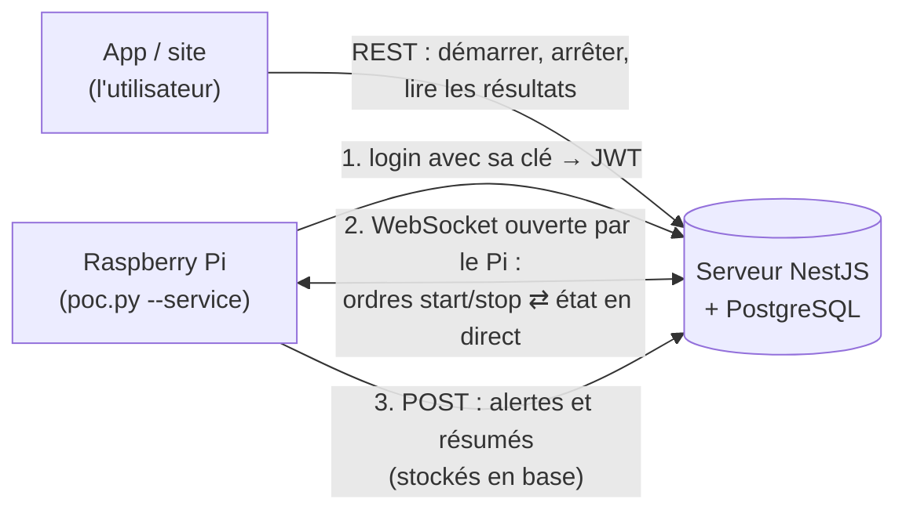
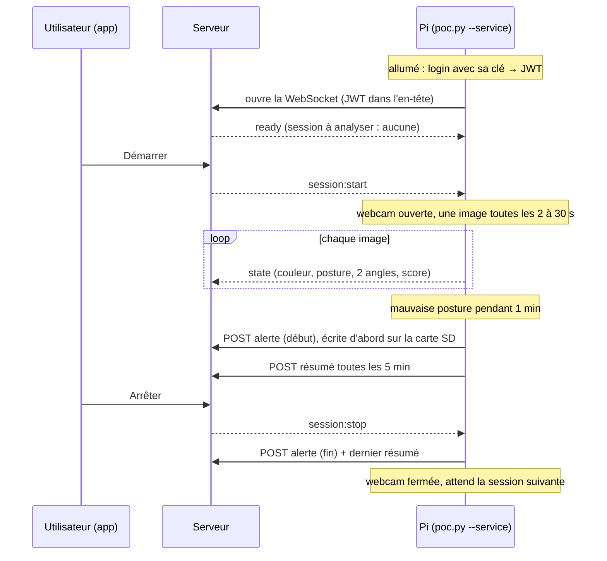

# La liaison Pi ↔ serveur, expliquée

Ce document raconte **ce qu'on a construit** pour relier le Raspberry Pi au serveur (parties A et B), **comment ça marche** et **pourquoi** on l'a fait ainsi, simplement, pour pouvoir l'expliquer à l'oral. Le détail exact (messages, champs, codes) est dans le contrat [liaison-serveur.md](liaison-serveur.md) ; ce qui reste à faire est dans [plan-liaison.md](plan-liaison.md).

## 1. Le problème de départ

Le Pi savait déjà analyser une posture tout seul : webcam de profil → MoveNet (17 points du corps) → angles → règles → alertes (voir [algo-posture.md](algo-posture.md)). Mais :

- il fallait le lancer **à la main**, dans un terminal ;
- ses résultats restaient **sur le Pi**, dans des fichiers CSV ;
- personne ne pouvait le voir travailler depuis l'app.

Le but : **l'utilisateur appuie sur « Démarrer » dans l'app, le Pi analyse, et les résultats arrivent au serveur**, sans perte, de façon sûre.

Règle qui ne change jamais : **aucune image ni aucun point du corps ne sort du Pi**. Seuls des chiffres sortent : une posture, une couleur, deux angles, un score, des durées (audit §7.2, RGPD).

## 2. La vue d'ensemble

Trois « tuyaux » entre le Pi et le serveur, chacun pour une raison :

| Tuyau | Ce qui passe | Pourquoi ce tuyau |
|---|---|---|
| **Login par clé** | la clé du Pi → un JWT (ticket d'entrée) | le Pi n'a pas de mot de passe ; il échange sa clé contre un ticket de courte durée |
| **WebSocket** | serveur → Pi : `session:start`, `session:stop` ; Pi → serveur : l'état de chaque image | c'est le seul moyen pour le **serveur de parler au Pi** sans connaître son adresse ; rapide, rien n'est stocké |
| **POST (REST)** | alertes (début, fin) et résumés de 5 min | ce qui est **stocké** doit arriver à coup sûr : une requête = une réponse, on sait si c'est reçu, on peut renvoyer |

## 3. Partie A : la liaison temps réel

### Pourquoi une WebSocket, ouverte par le Pi

Le serveur doit pouvoir dire au Pi « démarre » quand l'utilisateur appuie sur le bouton. Mais le serveur **ne peut pas appeler le Pi** : son adresse change (Wi-Fi de l'école), et ouvrir un port sur le Pi serait un risque.

Solution : **c'est le Pi qui appelle le serveur**, une fois, et la connexion **reste ouverte**. Ensuite, les deux côtés peuvent s'envoyer des messages quand ils veulent. Aucun port ouvert sur le Pi, ça passe les box et les pare-feu, comme un navigateur qui ouvre une page.

Pourquoi pas autre chose :
- **HTTP seul** : le Pi devrait demander « j'ai un ordre ? » toutes les X secondes (retard, requêtes inutiles) ;
- **SSE** : seulement dans le sens serveur → client ;
- **MQTT** : un serveur de plus à installer et sécuriser, trop pour un POC.

### Une connexion sécurisée (A1–A3)

1. Le Pi ouvre `wss://…/api/devices/ws` avec son jeton dans l'en-tête `Authorization: Bearer <JWT>` — **jamais dans l'adresse**, qui finit dans les journaux des serveurs.
2. Le serveur vérifie le jeton (même vérification que pour le reste de l'API) et que l'appareil est bien un Raspberry Pi ; sinon il ferme la connexion avec un code qui dit pourquoi (`4401` jeton refusé, `4403` pas un Pi).
3. S'il accepte, il envoie **`ready`** : le Pi attend ce message avant de parler (sinon ses premiers messages arriveraient avant la fin de la vérification).

Chaque message est du JSON `{ "event": "...", "data": ... }`, limité à 16 Ko, et **validé** par le serveur : un champ en trop (des points du corps, par exemple) fait refuser le message.

### Une connexion qui se répare toute seule (A4)

Le Pi garde la connexion dans un **fil d'exécution à part** (thread) : l'analyse ne l'attend jamais. Si la connexion tombe (Wi-Fi, serveur redémarré), il réessaie après 1 s, puis 2 s, 4 s… jusqu'à 60 s, pour ne pas bombarder un serveur en panne. Pendant une coupure, **l'analyse continue**.

### Le serveur pilote le Pi (A5)

| L'utilisateur fait (app) | Le serveur envoie au Pi | Le Pi |
|---|---|---|
| Démarrer | `session:start` | ouvre la webcam, analyse |
| Pause | `session:stop` | termine proprement, **éteint la webcam** |
| Reprendre | `session:start` | relance une analyse |
| Arrêter | `session:stop` | ferme ses alertes, envoie son dernier résumé |

**Et si le Pi était éteint au moment du clic ?** À chaque connexion, `ready` lui dit quelle session il **doit** analyser en ce moment (« la base fait foi »). Un Pi rallumé rattrape donc tout seul un « Démarrer » ou un « Arrêter » qu'il a manqué. Le Pi compare toujours avec ce qu'il fait déjà : un ordre reçu deux fois ne change rien.

### Le vrai programme, piloté (A6)

`poc.py --service` attend les ordres : la webcam n'est ouverte **que pendant une session** (moins de chauffe, plus de respect de la vie privée). À chaque image, il envoie l'**état en direct** (`state`) : couleur, posture, deux angles, score. Cet état n'est **jamais stocké** : le serveur garde seulement le dernier, pour l'afficher bientôt en direct dans l'app.

## 4. Partie B : fiable et sûre

### Les alertes et les résumés arrivent en base (B1)

Deux tables : `postureEvents` (les alertes) et `postureSummaries` (les bilans de 5 min). Le Pi les envoie par **POST**.

- **Une alerte = une ligne** : créée à son début, complétée à sa fin. Le Pi garde le même identifiant (`clientId`) au début et à la fin pour que le serveur sache quelle ligne compléter.
- **Pas de doublon** : si le Pi renvoie un message (réponse perdue après une coupure), le serveur reconnaît le `clientId` et renvoie la ligne déjà enregistrée. On dit que l'envoi est **idempotent** : le faire deux fois revient au même que le faire une fois.
- **Accepté aussi après l'arrêt** de la session : un Pi coupé du réseau au moment du stop envoie ses derniers résultats après coup.

### Rien ne se perd, même si tout va mal (B3)

Le Pi **écrit chaque message sur sa carte SD** (petite base SQLite) **avant** de l'envoyer, et ne l'**efface qu'une fois que le serveur a répondu « reçu »**. Ce qui reste (serveur injoignable, Pi éteint) part au démarrage suivant, dans l'ordre. Un message refusé (invalide) est mis de côté dans une table `rejetes` pour comprendre après coup. Tout est purgé après 7 jours.

Piège trouvé et corrigé : si le service redémarre pendant une session, il ne doit pas réutiliser `evt_0001` (le serveur le prendrait pour un renvoi). Les identifiants contiennent donc l'heure de début de l'analyse : `evt_20261019135429_0001`.

**Preuve** : serveur coupé 3 min, Pi redémarré pendant la coupure, serveur rallumé → 12 messages envoyés, **0 perdu, 0 doublon**.

### Une clé pour le Pi, plus de mot de passe (B2)

Au début, le Pi se connectait avec l'email et le mot de passe d'une personne. Problèmes : un mot de passe sur une carte SD, une session qui expire, impossible de couper un seul Pi.

Maintenant :
1. **Ajouter un Pi** : depuis le compte (`POST /devices`), ou d'une seule commande sur le Pi (`python -m outils.appairer`, mot de passe tapé une fois, jamais enregistré). Le serveur crée l'appareil et une **clé** aléatoire (256 bits), montrée **une seule fois** ; il n'en garde que l'**empreinte** (comme un mot de passe).
2. **Se connecter** : le Pi échange sa clé contre un JWT (`POST /auth/device-login`), puis l'utilise partout. Quand le JWT expire, il recommence tout seul.
3. **Couper un Pi** (perdu, volé) : révoquer sa clé → sa connexion est fermée **tout de suite** et il ne peut plus revenir.

Pourquoi échanger la clé contre un JWT plutôt que l'envoyer à chaque requête : même sécurité, mais tout le serveur fonctionne déjà avec le JWT ; seul le login change. La clé circule rarement, le JWT qui circule est de courte durée.

### Le Pi n'a que les droits dont il a besoin

Une session ouverte avec la clé est une **session d'appareil**. Le gardien de l'API (le *guard*, qui contrôle chaque requête) ne la laisse passer que sur les routes marquées **`@DeviceAllowed()`** : la WebSocket, l'envoi des alertes et des résumés. Partout ailleurs (le compte, les sessions, les appareils, l'administration) : **403**. Une clé volée ne donne donc pas accès au compte de la personne : c'est le principe du **moindre privilège**.

## 5. Une session, du début à la fin

## 6. Sécurité et vie privée, en résumé

| Risque | Ce qu'on a fait |
|---|---|
| Images, points du corps | ne quittent jamais le Pi ; le serveur refuse tout champ en trop |
| Quelqu'un se connecte à la place du Pi | clé de 256 bits, comparée en temps constant ; jeton vérifié avant tout message |
| Clé volée sur la carte SD | elle ne donne que les droits du Pi (`@DeviceAllowed`) ; on la révoque et le Pi est coupé tout de suite |
| Mot de passe sur le Pi | plus aucun (tapé une seule fois à l'appairage, jamais enregistré) |
| Jeton dans les journaux | toujours dans l'en-tête, jamais dans l'adresse |
| Données qui traînent | état en direct jamais stocké ; file du Pi purgée après 7 jours ; fichiers du Pi lisibles par son seul utilisateur |
| Caméra pendant une pause | éteinte (le serveur envoie `session:stop`) |

## 7. Questions qu'on peut te poser

- **Pourquoi ne pas tout envoyer par la WebSocket ?** Ce qui est stocké doit arriver à coup sûr : avec un POST, chaque message a sa réponse et peut être renvoyé sans doublon. La WebSocket sert à ce qui est urgent et jetable (ordres, état en direct).
- **Que se passe-t-il si le Wi-Fi coupe pendant une session ?** Le Pi continue d'analyser et garde ses résultats sur sa carte SD ; à la reconnexion, `ready` le remet à jour et la file se vide, sans doublon.
- **Et si le Pi redémarre ?** Les messages en attente sont sur la carte SD, ils partent au démarrage ; les nouveaux identifiants ne se mélangent pas aux anciens.
- **Pourquoi le serveur ne peut-il pas appeler le Pi ?** Pas d'adresse fixe, pas de port ouvert : c'est voulu, c'est plus sûr. Le Pi appelle, la connexion reste ouverte.
- **Pourquoi une clé plutôt qu'un mot de passe ?** Propre au Pi, longue et aléatoire, révocable sans toucher au compte, et sans droits sur le compte.
- **Le serveur refait-il l'analyse ?** Non : l'analyse en temps réel se fait sur le Pi (audit §7.1) ; le serveur stocke et agrège.
- **Limites connues ?** Une seule instance du serveur (liste des Pi connectés en mémoire) ; pas encore de WebSocket en prod derrière nginx ; un Pi redémarré pendant une coupure n'analyse pas tant qu'il n'a pas reçu `ready` (voir [plan-liaison.md](plan-liaison.md)).

## 8. Où est le code

| Partie | Fichiers |
|---|---|
| Pi : liaison, envoi, file, clé | `edge/posture/serveur.py` (`Liaison`, `Envoi`, `FileEnvoi`, `Jeton`, `commande()`) |
| Pi : la session pilotée | `edge/poc.py --service` |
| Pi : outils | `edge/outils/connexion.py` (tester), `edge/outils/appairer.py` (ajouter le Pi) |
| Serveur : WebSocket | `server/src/analysis/devices.gateway.ts`, `device-connections.ts`, `live-states.ts` |
| Serveur : ordres start/stop/pause | `server/src/analysis/analysis.service.ts` |
| Serveur : alertes et résumés | `server/src/analysis/posture-results.*` |
| Serveur : clé et droits | `server/src/devices/`, `server/src/auth/device-key.ts`, `auth.service.ts` (`deviceLogin`), `auth.guard.ts` (`@DeviceAllowed`) |
| Tests | `edge/tests/test_serveur.py`, `edge/tests/test_appairer.py` ; essais sur le vrai Pi : [poc-raspberry.md](poc-raspberry.md) §7 |
